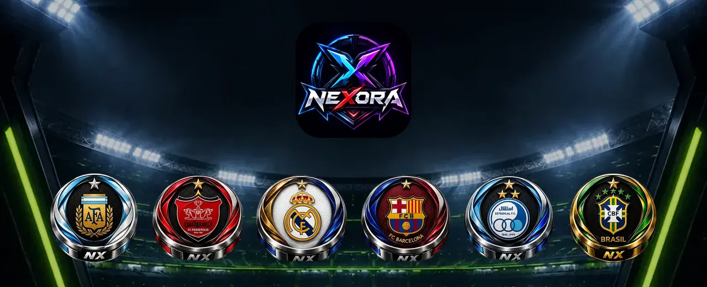
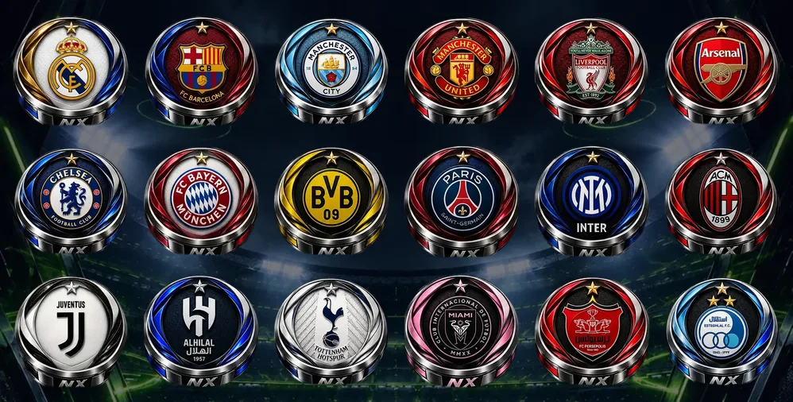
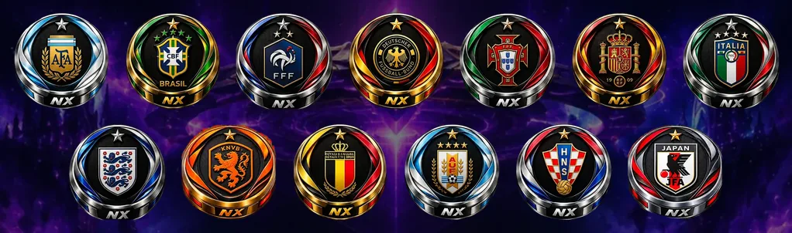
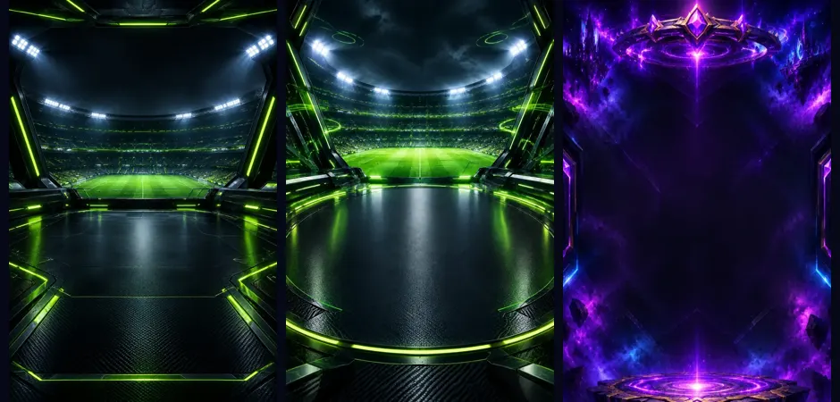
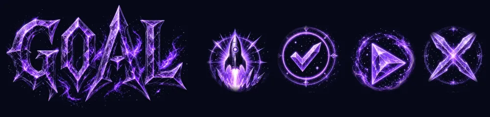

<p align="center">
  
</p>

<h1 align="center">⚡ NEXORA · فوتبال دیسکی</h1>

<p align="center">
  <b>فوتبال انگشتی با دیسک‌های فلزی NX، آرناهای پرهیجان، جام جهانی ماهانه و رقابت آنلاین زنده</b>
</p>

<p align="center">
  <a href="https://github.com/nexoragameb-png/NEXORA-/releases/latest"></a>
  
  
  
  
</p>

<div dir="rtl" align="right">

## 🎮 نکسورا چیست؟

**نکسورا** یک بازی فوتبال دیسکی (فوتبال انگشتی) برای موبایل است: دیسکت را با انگشت بکش، زاویه و قدرت را تنظیم کن و رها کن تا توپ را به دروازه‌ی حریف بفرستی. بازی کاملاً **فارسی و راست‌به‌چپ** است، هم **آفلاین** مقابل هوش مصنوعی و دوستانت اجرا می‌شود و هم **آنلاین** با بازیکن‌های واقعی، چت صوتی و متنی، باشگاه‌ها و تورنمنت‌ها.

---

## 📥 دانلود

<p align="center">
  <a href="https://github.com/nexoragameb-png/NEXORA-/releases/latest"><b>⬇️ دانلود آخرین نسخه‌ی APK اندروید</b></a>
</p>

- آخرین فایل `nexora-*.apk` را از بخش **Assets** همان صفحه دانلود و نصب کن (نصب از منابع ناشناس باید فعال باشد).
- هر بار که کد به شاخه‌ی `main` می‌رسد، GitHub Actions به‌صورت خودکار یک APK تازه می‌سازد و در [Releases](https://github.com/nexoragameb-png/NEXORA-/releases) منتشر می‌کند.
- نسخه‌های فعلی، بیلد آزمایشی هستند و با کلید دیباگ امضا شده‌اند.

---

## ✨ امکانات

### 🕹️ حالت‌های آفلاین

| حالت | توضیح | جایزه |
|:---:|:---|:---:|
| ⚡ بازی سریع | یک مسابقه‌ی فوری مقابل هوش مصنوعی | سکه، XP و جام |
| 🏆 جام نکسورا | سه حریف پشت سر هم تا فینال؛ هر مرحله سخت‌تر | ۲ برابر + ۲۰ الماس برای قهرمان |
| 🌌 چالش کهکشانی | دو دقیقه مقابل ربات افسانه‌ای | ۳ برابر جایزه |
| 👥 دو نفره | با دوستت روی یک گوشی بازی کن | افتخار! |
| 🎯 تمرین | بدون تایمر، ربات آسان، برای گرم کردن دست | XP کم |

سه سطح هوش مصنوعی (آسان، معمولی، سخت)، ۶ ترکیب تاکتیکی، ۲۹ زمین متنوع و ۳۶ توپ با ردّ نور اختصاصی.

### 🌐 حالت‌های آنلاین

- **مسابقه‌ی سریع ۱ به ۱، ۲ به ۲ و ۳ به ۳** با سیستم هم‌تراز‌سازی بر اساس رتبه
- **اتاق‌های اختصاصی** با کد، جایگاه تیم آبی و قرمز، اعلام آمادگی، تماشاگر، انتقال میزبانی و تنظیم قوانین (تا ۳ یا ۵ گل، ۳ یا ۵ دقیقه، زمان هر نوبت، انتخاب زمین)
- **جایگاه خالی؟ مشکلی نیست:** میزبان می‌تواند بازی را شروع کند و ربات جای بازیکنان غایب بازی می‌کند (بازی دوستانه، بدون امتیاز). در جستجوی سریع هم پس از ۲۰ ثانیه گزینه‌ی «بازی با ربات» ظاهر می‌شود
- **لیگ‌ها و رتبه‌بندی** با امتیاز ELO، فصل‌ها و جوایز فصلی
- **چالش‌های روزانه** با جایزه‌ی الماس
- **تورنمنت‌ها** با فرمت‌های حذفی، دوحذفی، دوره‌ای، سوئیسی و لیگ
- پخش زنده‌ی بازی برای تماشاگرها و **چت صوتی** داخل اتاق

### 🏟️ آرناها (دوئل با ورودی و جایزه)

| آرنا | ورودی | جایزه‌ی برنده | قانون |
|:---|:---:|:---:|:---|
| آرنای برمودا | ۱۰۰ سکه | ۲۰۰ سکه | قوانین عادی · تا ۳ گل |
| آرنای نکسورا | ۲۵۰ سکه | ۵۰۰ سکه | اولین تیمی که ۳ گل بزند |
| آرنای NX | ۵۰۰ سکه | ۱٬۰۰۰ سکه | ۵ دقیقه · جلوتر برنده است |
| آرنای فضا | ۲٬۰۰۰ سکه | ۴٬۰۰۰ سکه | ۳ دقیقه |
| آرنای کاکرو | ۵۰ الماس | ۱۰۰ الماس | اولین تیمی که ۵ گل بزند |

ورودی هنگام شروع بازی روی سرور نگه داشته می‌شود، به برنده پرداخت می‌شود و در صورت تساوی یا لغو بازی به همه برمی‌گردد.

### 🌍 جام جهانی ماهانه

هر ماه **۶۴ بازیکن برتر** رتبه‌بندی ماهانه به جام جهانی نکسورا راه پیدا می‌کنند: **۱۶ گروه ۴ نفره**، سپس مرحله‌ی حذفی تا فینال. قهرمان **۵۰۰ الماس** جایزه می‌گیرد. (جوایز تورنمنت‌های معمولی فقط الماس و حداکثر ۳۰ عدد است.)

### 🛡️ ۳۱ تیم با دیسک‌های فلزی NX

همه‌ی دیسک‌ها یک سبک یکدست دارند: دیسک فلزی سه‌بعدی با نشان تیم و پلاک **NX**.

<p align="center"><b>۱۸ باشگاه</b></p>
<p align="center"></p>

رئال مادرید · بارسلونا · منچسترسیتی · منچستریونایتد · لیورپول · آرسنال · چلسی · بایرن مونیخ · بوروسیا دورتموند · پاری‌سن‌ژرمن · اینتر · آث میلان · یوونتوس · الهلال · تاتنهام · اینترمیامی · **پرسپولیس** · **استقلال**

<p align="center"><b>۱۳ تیم ملی</b></p>
<p align="center"></p>

آرژانتین · برزیل · فرانسه · آلمان · پرتغال · اسپانیا · ایتالیا · انگلیس · هلند · بلژیک · اروگوئه · کرواسی · ژاپن

### 💪 قدرت و دقت دیسک‌ها

هر دیسک دو آمار واقعی از **۱ تا ۱۰** دارد که مستقیماً روی بازی اثر می‌گذارد:

- **قدرت (Power):** حداکثر سرعت و ضربه‌ی شوت
- **دقت (Accuracy):** هرچه بیشتر، انحراف تصادفی ضربه کمتر

| نوع | تعداد | قیمت |
|:---|:---:|:---:|
| دیسک‌های رایگان شروع | ۹ | رایگان |
| دیسک‌های ویژه | ۲۲ | ۱۳۰ تا ۳۰۰ الماس |
| بسته‌های دیسک | ۶ | ۱۳۰ تا ۳۰۰ الماس |

### 💬 اجتماعی، باشگاه و چت

- **پروفایل عمومی** با عکس، بیوگرافی، دنبال کردن، پیام خصوصی، مسدودسازی و دعوت به بازی
- **چت زنده** با ارسال تصویر و وضعیت خوانده‌شدن، گروه‌ها و اتاق‌های گفتگوی صوتی
- **باشگاه‌ها** با نقش رهبر، افسر و عضو، درخواست عضویت، چت اختصاصی و **چالش تیمی بین باشگاه‌ها**
- **ثبت‌نام و ورود** با ایمیل و رمز عبور، بازیابی رمز، و تبدیل حساب مهمان به حساب دائمی بدون از دست رفتن پیشرفت

### 🔮 اوراکل، دستیار بازی

**اوراکل** همراه بازیگوش نکسوراست: روی صفحه‌ی اصلی نکته می‌دهد، چالش‌ها و جوایز آماده را یادآوری می‌کند و با بیش از ۱۵ حالت چهره واکنش نشان می‌دهد. کاملاً آفلاین و بدون سرویس هوش مصنوعی بیرونی کار می‌کند.

### 🎨 گرافیک

- رندر زمین و دیسک‌ها با **Skia** روی GPU: سایه، ردّ نور توپ، موج انفجار گل و لرزش دوربین
- توپ سه‌بعدی چرخان با شیدر اختصاصی
- پس‌زمینه‌های استادیوم نئونی و پورتال بنفش با لایه‌ی تیره برای خوانایی
- جلوه‌ی نئونی **GOAL** هنگام گل و آیکون‌های نئونی شروع و آمادگی در اتاق‌ها
- اینتروی «پرواز به نکسورا» با پرش فضایی
- حالت **«روان»** برای گوشی‌های ضعیف‌تر

<p align="center">
  
</p>
<p align="center">
  
</p>

---

## 🧰 فناوری‌ها

| بخش | فناوری |
|:---|:---|
| اپلیکیشن | React Native 0.88 · Expo SDK 58 · TypeScript |
| گرافیک | @shopify/react-native-skia · Reanimated · Expo Linear Gradient |
| فیزیک | موتور اختصاصی دوبعدی (برخورد، اصطکاک، چرخش توپ، تیرک دروازه) |
| بک‌اند | Supabase: Postgres · Auth · Realtime · Storage · pg_cron |
| شبکه‌ی بازی | میزبان‌محور: میزبان شبیه‌سازی می‌کند و بقیه اسنپ‌شات‌ها را درون‌یابی می‌کنند |
| صدا | LiveKit (چت صوتی) · expo-audio (جلوه‌ها و موسیقی) |
| بیلد | GitHub Actions → APK اندروید در Releases |

---

## 🛠️ اجرا و ساخت

پیش‌نیازها: Node.js 22، npm و برای بیلد اندروید JDK 17 و Android SDK.

```bash
git clone https://github.com/nexoragameb-png/NEXORA-.git
cd NEXORA-
npm ci

# اجرا در حالت توسعه (Development Build لازم است؛ ماژول‌های بومی مثل Skia و LiveKit در Expo Go نیستند)
npx expo start

# بررسی‌ها
npx tsc --noEmit
npx expo-doctor

# ساخت APK محلی (پوشه‌ی android به‌صورت خودکار تولید می‌شود؛ دستی ویرایشش نکن)
npx expo prebuild --platform android
cd android && ./gradlew assembleRelease
```

### بک‌اند (Supabase)

فایل‌های SQL را به ترتیب در SQL Editor پروژه اجرا کن (همه قابل اجرای دوباره هستند):

1. `supabase/schema.sql`
2. `supabase/schema_v2.sql`
3. `supabase/schema_v3.sql`
4. `supabase/schema_v4.sql`

آدرس و کلید عمومی پروژه در `src/net/publicConfig.ts` است و با `EXPO_PUBLIC_SUPABASE_URL` و `EXPO_PUBLIC_SUPABASE_ANON_KEY` قابل تغییر است. تابع لبه‌ی `supabase/functions/livekit-token` توکن چت صوتی را صادر می‌کند.

### ساختار پروژه

```
App.tsx              ناوبری اصلی، تب‌ها و اینترو
src/game/            موتور فیزیک، رندر Skia، داده‌ی تیم‌ها و زمین‌ها
src/screens/         خانه، بازی، تیم، فروشگاه، پروفایل، ثبت‌نام
src/online/          لابی، مسابقه‌ی آنلاین، آرنا، جام جهانی، تورنمنت، رتبه‌ها
src/social/          چت، باشگاه، پروفایل عمومی
src/net/             Supabase، احراز هویت، دیسک‌ها، صدا
supabase/            اسکیمای پایگاه‌داده و تابع لبه
assets/g/            تصاویر تیم‌ها، زمین‌ها، توپ‌ها، پس‌زمینه‌ها و صداها
```

---

## 📝 تغییرات نسخه‌ی ۲.۰.۱

- اتاق‌ها حالا واقعاً شروع می‌شوند: جایگاه‌های خالی با ربات پر می‌شوند و جستجوی سریع گزینه‌ی بازی با ربات دارد
- صفحه‌ی کامل ثبت‌نام و ورود با نام کاربری، ایمیل و رمز عبور
- فقط ۳۱ تیم با دیسک‌های فلزی یکدست NX، قیمت‌ها و بسته‌های جدید
- پس‌زمینه‌های جدید استادیوم و پورتال، دیسک‌های ۱۶٪ بزرگ‌تر، جلوه‌ی نئونی گل

---

## 👨‍💻 سازنده

<p align="center">
  طراحی و توسعه: <b>اشکان کاکرو</b> (Ashkan Kakero)
</p>

<p align="center">
  ساخته‌شده با ❤️ برای عاشقان فوتبال
</p>

</div>
